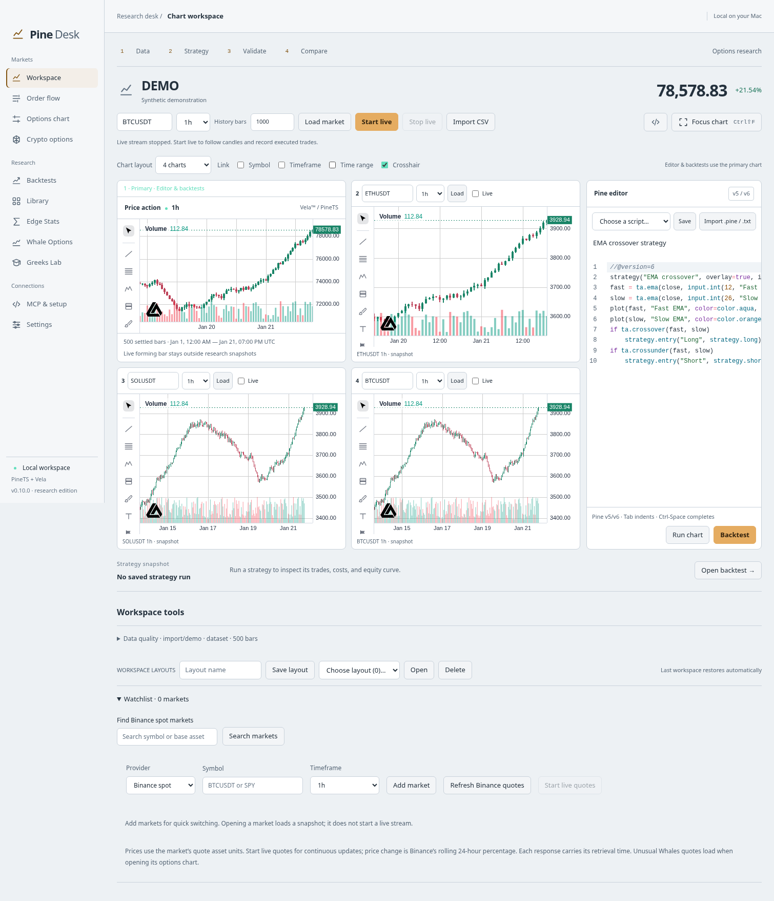

# Linked charts and live watchlists

Available in **v0.10.0**. Open **Workspace → Chart layout** and choose one, two or four charts. The first chart is the **primary**: the Pine editor, backtests, sweeps, data-quality checks and order-flow buffer continue to use that chart's dataset. Comparison panels cannot overwrite it.

The screenshot uses deterministic test data to illustrate the layout.

## Compare markets

Each comparison has a Binance spot symbol, timeframe, **Load** button and **Live** checkbox. Load retrieves up to 1,000 settled candles; Live subscribes to candles and raw trades using the existing Binance reconnect/gap handling. Comparison buffers retain at most 1,000 candles and 1,000 prints per unique subscription; the primary keeps its existing larger research/order-flow buffer. Forming candles are display-only.

- **Symbol:** comparisons follow the primary's symbol when the primary has Binance provenance. Imported CSV and demo symbols are not automatically treated as exchange instruments.
- **Timeframe:** comparisons follow the primary timeframe. With it disabled, compare several intervals of one market.
- **Time range:** pan/zoom or an MCP range change follows across visible charts in Unix time. Different intervals/loaded histories may have empty regions; charts do not invent missing bars.
- **Crosshair:** the cursor time follows across charts. The horizontal price level follows only between matching symbols and from the price pane.

These toggles define one workspace link group. Comparison charts have independent Vela drawings and indicators. Their studies use separate Pine workers. The app's script editor and MCP script execution target the primary only; there is no separate comparison editor or backtest target selector yet.

Matching comparison markets/timeframes share one subscription. If the primary is already streaming the same market/timeframe, comparisons reuse it. Turning off one panel does not disconnect another consumer. Reducing the layout releases unused comparison connections; navigating to another page keeps explicitly started streams running in the service. Quitting stops everything.

## Save and restore

The last workspace remembers the grid, comparison markets, link toggles, drawings and indicators. On restart, comparison histories load fresh REST snapshots; **live checkboxes are not automatically restarted**. Named layouts include settled primary/comparison snapshots and can reopen those snapshots offline with streams stopped. Click a comparison's Load or Live control to return it to current provider data. The comparison service is configured as a group, so refreshing from a saved grid refreshes its visible comparisons together.

Old single-chart layouts remain supported. Named layouts retain the existing 25 MB total limit. Source/indicator limits and the 30-second indicator-restore deadline still apply. Large grids with many studies consume more CPU and memory; start with two charts on smaller Macs.

## Watchlists and market search

Under **Workspace tools → Watchlist**, search Binance by symbol or base asset. Results come from public exchange metadata, cached for one hour, limited to currently trading spot pairs and 30 matches. Selecting a result fills the market and watchlist inputs; choose Add market or Load market to use it.

**Start live quotes** opens one combined Binance `@ticker` WebSocket for the unique Binance symbols in the saved watchlist (up to 50 entries). Prices are in the pair's quote asset and percentages are Binance's rolling 24-hour changes. Quotes carry exchange event and local receipt times; hover over a quote to see the event timestamp. Missing, disconnected or more-than-30-second-old updates are not presented as current: old values are marked stale, and the connection status reports reconnects/errors. A newly added symbol can show no quote until its first valid ticker event. Stop live quotes releases watchlist subscriptions; enabled alerts may keep the shared ticker connection open. Chart streams remain independent.

Unusual Whales watchlist entries still open the existing options view; they do not use the Binance ticker stream. No API key is needed for public Binance data, but regional/network availability still applies. Search/history/stream failures remain visible and do not substitute demonstration prices.

## MCP

Attached clients share the same service and can use:

- `desktop_state`: primary `workspace` plus visible `compare-1`, `compare-2`, `compare-3` panels, instrument identity, timeframe, coverage, range and status.
- `desktop_chart_set_range`: accepts any currently loaded panel ID; linked charts follow if enabled. Requires chart permission.
- `chart_panels_snapshot`: the displayed comparison snapshots, including restored named-layout data, in attached mode; service subscriptions in standalone mode.
- `watchlist_snapshot`: quotes, event/receipt times, connection state and per-symbol stale flags.
- `market_search`: public spot metadata search.

Configure grids and start comparison/watchlist streams in the desktop UI. Read tools do not grant permission to change the layout or start new subscriptions. `run_backtest` and other strategy tools continue to capture the primary chart's settled data.

## Scope and checks

This is the chart/monitoring foundation of roadmap milestone 2. Multiple named watchlists, live sorting/saved screeners, a command palette, multiple link groups and independent per-panel script editors remain follow-up work. Equity/options comparison panes and additional live quote providers are not part of this grid. [Persistent Binance spot alerts](local-alerts.md) are available in v0.11.0 and share the ticker connection with watchlists. DOM/depth remains a separate milestone.

Tests cover subscription sharing/cleanup, late-history responses, invalid requests, ticker reconnects and staleness, cached search, layout validation, linked range interaction, snapshot restoration and primary research isolation. Native Electron smoke exercises four charts and MCP range control, then verifies a comparison reuses the primary stream without an extra connection. Provider transports are deterministic fixtures in CI; public endpoint availability and paid entitlements are separate checks.
