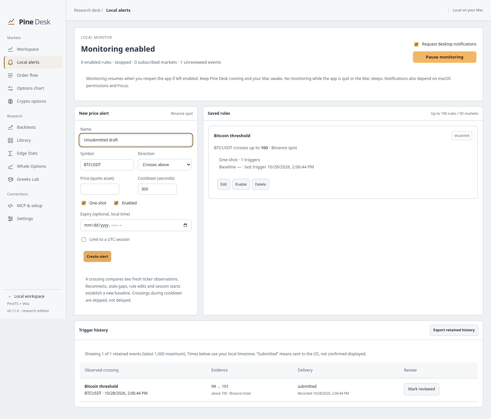

# Persistent local price alerts

Available in **v0.11.0**. Open **Local alerts** in the sidebar, or **Workspace → Price alert** to prefill a rule from the primary Binance chart. No API key is needed for public Binance spot tickers.



This screenshot uses deterministic test prices.

## Create and run a rule

1. Enter a name, spot pair (for example `BTCUSDT`), crossing direction and price in the pair's quote asset.
2. Choose one-shot or repeating behavior. Cooldown is 1–604,800 seconds (default 300); it also applies when re-enabling an existing rule.
3. Optionally set an expiry in your Mac's local time, or a UTC session with weekdays.
4. Save the rule, then select **Start monitoring**. Monitoring is initially off. Turn desktop notification requests on or off independently.

Rules can be edited, disabled/re-enabled and deleted. Deleting a rule preserves its recorded trigger evidence. Up to 100 rules are saved, with up to 50 distinct symbols among enabled rules. Expired rules remain visible; disable/delete them when no longer needed.

**Leave Pine Desk running and the Mac awake.** The main process evaluates alerts without an open chart and while other pages are displayed. On macOS it can continue after the window is closed while the application remains running. Quitting the app or sleeping the Mac interrupts monitoring. If monitoring was left enabled, saved rules resume when the owning desktop or standalone MCP service starts again. This is a local monitor, not a cloud service or an always-on system daemon.

## What counts as a crossing

Alerts use Binance's public `@ticker` **last-price observations**, normally updated about once per second. They do not inspect every executed trade, and a move out and back between observations can be missed.

- **Above:** the previous observed price was strictly below the threshold and the new price is at or above it.
- **Below:** the previous observed price was strictly above the threshold and the new price is at or below it.
- The first fresh observation establishes a baseline. Starting while already beyond a threshold does **not** immediately fire.
- A restart, reconnect, subscription change, stale gap longer than 30 seconds, pause/resume, rule edit or new session establishes a new baseline. Crossings during missing coverage are not reconstructed.
- Duplicate/out-of-order packets are ignored. Stale or implausibly future-dated packets cannot trigger rules.
- A repeating rule must cross again after its cooldown. Crossings during cooldown are consumed and skipped; there is no delayed catch-up notification.
- A one-shot rule is durably disabled when it fires. Re-enable it explicitly if needed.

Example: an above-100 alert sees `101` first (baseline), then `99`, then `100`: it fires on the `99 → 100` observation. If it instead sees `99`, disconnects, then reconnects at `101`, the `101` quote establishes a new baseline without triggering.

Sessions use UTC minute boundaries and selected **event calendar weekdays**. The start is inclusive and end exclusive. An overnight `22:00–02:00` window uses each observation's UTC calendar day for its weekday filter. Session starts and ends must differ; leave sessions disabled for all-day monitoring. Both current processing time and the quote timestamp must satisfy the session and expiry. DST is not applied to UTC sessions.

## Shared feeds and health

Watchlists and alerts share a combined ticker connection. Matching symbols are subscribed once; stopping watchlist quotes does not stop alerts, and pausing alerts leaves an active watchlist running. The combined connection allows the union of each consumer's 50-symbol limit (up to 100 symbols total). Chart candle/trade streams remain separate because they use different event types.

Changing the union of symbols reconnects this ticker feed. Alerts establish new baselines afterward. The status panel shows the connection state, subscribed market count, errors and unreviewed triggers. Rule cards distinguish paused, disabled, expired, outside-session, waiting-for-fresh-baseline and armed states. Network or regional restrictions can prevent Binance access; no synthetic prices are substituted.

A failed storage write or an overloaded quote queue stops alert monitoring, releases its feed subscriptions and reports an error. Watchlist subscriptions remain independent. Resolve the problem, then select Start monitoring to resume with fresh baselines. Corrupt saved alert data is reported and is not silently overwritten. Back up and repair the `alerts/current.json` file in the app data directory, then restart the owning app/service to retry loading it.

## History and notification delivery

The last **1,000 events** are retained in the local alert document. Each event records the rule ID/name, provider, symbol, direction, threshold, previous/current prices, exchange timestamps, receipt time and trigger time. Rule trigger counts remain cumulative even as old history falls out of the retained window. The screen shows the latest 100; **Export retained history** exports all retained events as JSON. Mark reviewed acknowledges an event without deleting evidence.

Rule disarming/cooldown state and trigger evidence are saved together, using the app's atomic file replacement, **before** requesting an OS notification. Baselines stay in memory and are deliberately not restored after restart.

Notification states are:

| State | Meaning |
| --- | --- |
| `disabled` | Notification requests were turned off; history was still recorded. |
| `submitted` | The request was handed to the OS notification adapter. Display, sound and user attention are not confirmed. |
| `unavailable` | No desktop notification adapter was available (for example standalone MCP). |
| `failed` | Submission raised an error. |
| `pending` / Delivery unconfirmed | History was saved but delivery completion was not saved, such as during a crash. |

Allow Pine Desk notifications in **macOS System Settings → Notifications**, and check Focus settings if messages do not appear. History remains the durable record. Unconfirmed delivery is not automatically retried on restart, avoiding duplicate notifications; a crash can therefore leave a recorded event without an OS notification. Notification content is local market/rule information, never API keys. This feature sends no email, SMS, Discord, webhook or broker orders.

## MCP

Read access includes `alerts_status` and `alerts_history`. Under **MCP & setup**, explicitly enable **Allow alert rules, monitoring and acknowledgements** for mutations. Existing bridge configurations migrate with this permission off, even if chart, stream and research controls were already enabled. Apply access and reconnect the client.

| Tool | Purpose |
| --- | --- |
| `alerts_status` | Saved definitions, rule state/baseline, feed health and unread count |
| `alerts_history` | Latest 1–1000 retained events and delivery state |
| `alerts_create` | Create a saved rule |
| `alerts_update` | Replace a definition; preserve trigger counts/cooldown and reset baseline |
| `alerts_delete` | Remove a rule while retaining existing event evidence |
| `alerts_configure` | Persist monitoring/notification preferences; enabling can start subscriptions |
| `alerts_acknowledge` | Mark an event as reviewed |

Example `alerts_create` arguments:

```json
{
  "rule": {
    "name": "BTC above 100000",
    "symbol": "BTCUSDT",
    "direction": "above",
    "price": 100000,
    "once": true,
    "cooldownSeconds": 300,
    "enabled": true,
    "expiresAt": null,
    "session": null
  }
}
```

Enable monitoring separately with `alerts_configure` and `{"monitoring":true,"notifications":true}`. Expiry values are Unix milliseconds; session objects use `startMinuteUTC`, `endMinuteUTC` and `daysUTC` (`0=Sunday` through `6=Saturday`). An attached client shares the running app's rules and connection. Disconnecting the client does not stop desktop-owned alerts. Standalone mode needs exclusive storage ownership; it records events but has no native notification adapter.

## Scope and verification

This release implements local **Binance spot price crossings**. Pine indicator alerts, volume/delta rules, GEX/options alerts, equity feeds, chart-drawn alert lines, external delivery and missed-event backfill are separate follow-up work.

Tests cover true crossing semantics, equality, cooldowns, stale/reconnect gaps, session/expiry gating, persistence/restart, atomic history-before-notification behavior, storage failures, bounded rule/history retention, shared subscriptions and MCP permission migration. Browser tests cover editing, monitoring, history, acknowledgement and preserving an unsaved form during refresh. Native source and packaged-app smoke tests exercise the actual service and attached MCP, then reopen the app to check persistence. CI uses deterministic transport and notification fixtures; it does not assert that a macOS notification banner actually appears.
